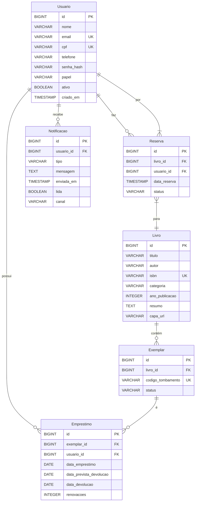
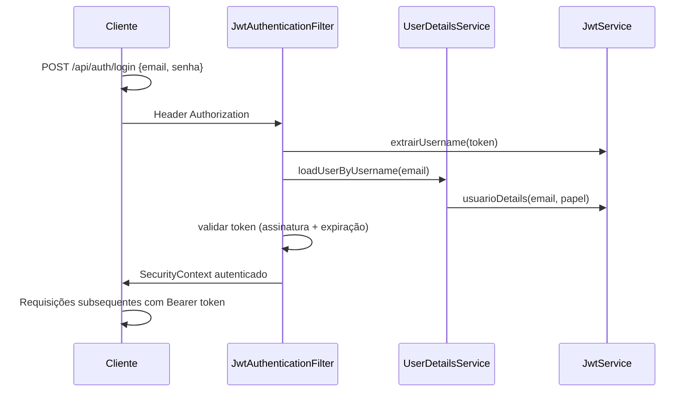

# Arquitetura da Biblioteca Betim API

> Documentação gerada a partir do código-fonte. Se houver divergência, o código é a fonte de verdade.

## Visão geral

A API segue a arquitetura em camadas tradicional do Spring Boot:

```
Controller → Service → Repository → PostgreSQL
                    ↘
                 Security (JWT, Filtro)
                    ↘
                 NotificacaoService (SMTP/MailHog)
```

## Diagrama ASCII da Arquitetura

```
┌─────────────────────────────────────────────────────────────────────────┐
│                           CLIENTE (Frontend)                           │
│  Requisições HTTP → Authorization: Bearer <token>                       │
└─────────────────────────────────────────────────────────────────────────┘
                                    │
                                    ▼
┌─────────────────────────────────────────────────────────────────────────┐
│                          WebMvc / Controllers                            │
│  - AuthController       (registro, login)                              │
│  - EmprestimoController (empréstimo, devolução, renovação)              │
│  - ExemplarController   (CRUD de exemplares)                          │
│  - LivroController      (catálogo de livros)                           │
│  - ReservaController    (reservas e fila)                              │
│  - NotificacaoController (meus dados, notificações)                     │
│  - MeController         (endpoints do usuário logado)                  │
└─────────────────────────────────────────────────────────────────────────┘
                                    │
                                    ▼ JWT + Filter
┌─────────────────────────────────────────────────────────────────────────┐
│                       JwtAuthenticationFilter                            │
│  1. Lê header "Authorization: Bearer <token>"                           │
│  2. Extrai username e papel do token (JJWT)                             │
│  3. Valida assinatura e expiração                                       │
│  4. Popula SecurityContext                                            │
└─────────────────────────────────────────────────────────────────────────┘
                                    │
                                    ▼
┌─────────────────────────────────────────────────────────────────────────┐
│                         Service Layer                                    │
│                                                                          │
│  EmprestimoService      → Regra: limite 3 ativos, bloqueia atraso       │
│  ExemplarService        → Gestão de exemplares (tombamento único)       │
│  LivroService           → Busca com fetch join de exemplares            │
│  NotificacaoService     → Criação @Async, envio email, deduplicação    │
│  ReservaService         → Fila de espera, notificação ao atender      │
│  UsuarioService         → Registro de morador, busca por email         │
│  ReservaService         → Processa fila de reservas                    │
└─────────────────────────────────────────────────────────────────────────┘
                                    │
                                    ▼
┌─────────────────────────────────────────────────────────────────────────┐
│                       Repository Layer                                   │
│                                                                          │
│  EmprestimoRepository   → Derived queries + Custom JPQL                 │
│  ExemplarRepository     → By codigoTombamento                         │
│  LivroRepository        → @Query + @EntityGraph (fetch join)          │
│  NotificacaoRepository  → With unique constraint (uk_notificacao...)   │
│  ReservaRepository      → With lock pessimista (FOR UPDATE)             │
│  UsuarioRepository      → By email, existsByEmail, existsByCpf          │
└─────────────────────────────────────────────────────────────────────────┘
                                    │
                                    ▼
┌─────────────────────────────────────────────────────────────────────────┐
│                           PostgreSQL 16                                  │
│  Tabelas: usuario, livro, exemplar, emprestimo, reserva, notificacao   │
│  Índices otimizados para buscas por usuário e data                       │
└─────────────────────────────────────────────────────────────────────────┘
```

## Modelo de Dados (ER Diagram)



## Enums

| Enum | Valores | Descrição |
|------|---------|-----------|
| `Papel` | MORADOR, BIBLIOTECARIO | Papéis de acesso |
| `StatusExemplar` | DISPONIVEL, EMPRESTADO, RESERVADO, INDISPONIVEL | Status do exemplar |
| `StatusReserva` | ATIVA, ATENDIDA, CANCELADA, EXPIRADA | Status da reserva |
| `TipoNotificacao` | LEMBRETE_DEVOLUCAO, ATRASO, RESERVA_DISPONIVEL | Tipos de notificação |
| `CanalNotificacao` | EMAIL | Canal de notificação (extensível) |

## Regras de Negócio Principais

### Empréstimo
- **Limite**: Máximo de 3 empréstimos simultâneos por usuário (`MAX_LOANS_PER_USER`)
- **Atraso**: Bloqueia novo empréstimo se houver atraso pendente
- **Renovação**: Máximo de 2 renovações, apenas se não houver reserva ATIVA para o livro
- **Prazo**: 14 dias padrão (`LOAN_DAYS`), configurável

### Devolução
- Quando há fila de reservas: primeiro da fila é notificado e exemplar fica `RESERVADO`
- Tempo de retenção da reserva: 48 horas (`RESERVATION_HOURS`)

### Reserva
- Só pode ser feita quando **não há** exemplar `DISPONIVEL`
- **Uma reserva ATIVA** por usuário por livro
- Posição na fila calculada por ordem de `data_reserva` ASC

### Notificação
- **Deduplicação**: mesmo tipo para o mesmo usuário no mesmo dia (constraint única no BD)
- **Assíncrono**: `@Async` para não bloquear fluxo principal
- **Envio**: via JavaMailSender (MailHog em dev, SMTP real em prod)

### Segurança
- **Autenticação**: JWT stateless (sem sessão no servidor)
- **Autorização**: baseada em papéis (`hasRole('BIBLIOTECARIO')`, `hasRole('MORADOR')`)
- **Proteção de endpoints**:
  - `/api/livros/**` (CRUD) → BIBLIOTECARIO
  - `/api/emprestimos/**` → BIBLIOTECARIO
  - `/api/me/**` → qualquer usuário autenticado

## Fluxo de Autenticação



## Configurações Relevantes

### application.yml (dev profile)
- Porta: 8080
- DB_HOST: localhost, DB_PORT: 5432 (via Docker)
- JWT_SECRET: `change-me-in-production-min-32-chars`
- JWT_EXPIRATION_MS: 86400000 (24h)
- SMTP: localhost:1025 (MailHog em dev)
- Logging: DEBUG para a aplicação

### AppProperties (configurações de negócio)
```java
Library:
  loanDays: 14
  maxRenewals: 2
  maxLoansPerUser: 3
  reservationHoldHours: 48
```

## Jobs Agendados

| Job | Cron | Função |
|-----|------|--------|
| NotificacaoJob.verificarEmprestimos | `0 0 8 * * *` | Diário 08:00 - Lembrete/Atraso |
| NotificacaoJob.expirarReservas | `0 0 * * * *` | A cada hora - Expira reservas não retiradas |

## Decisões Arquiteturais

1. **JWT Stateless**: Não há sessão no servidor; o token contém todas as informações necessárias.
2. **Flyway**: Migrações versionadas no banco; `baseline-on-migrate: true` em dev.
3. **Testcontainers**: Testes de integração rodam contra PostgreSQL real em container.
4. **MailHog**: Em dev, e-mails são capturados para teste sem SMTP real.
5. **DevDataLoader**: Seed de desenvolvimento com dados de exemplo (perfil `dev`).